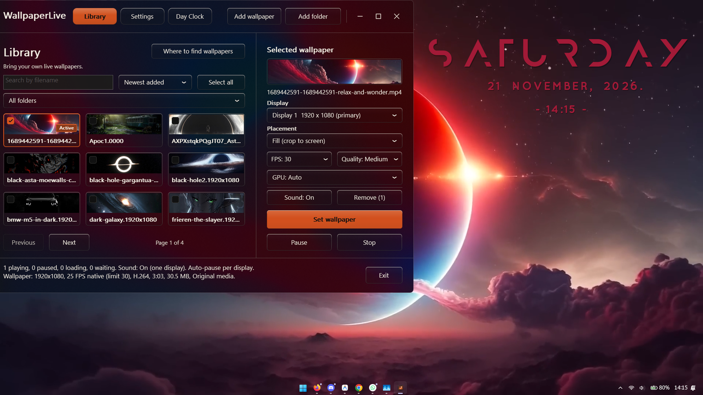
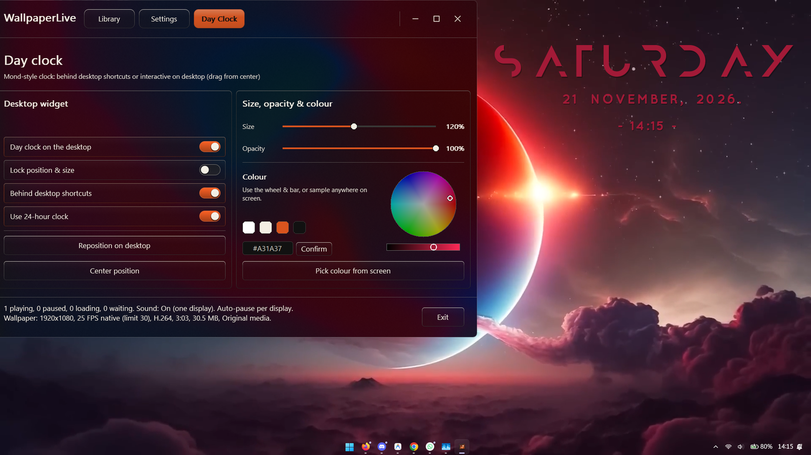
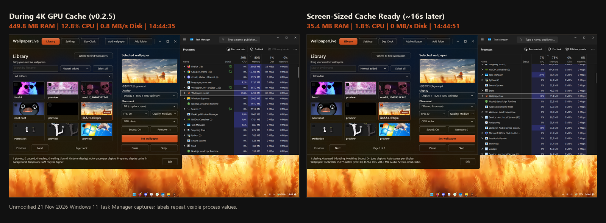
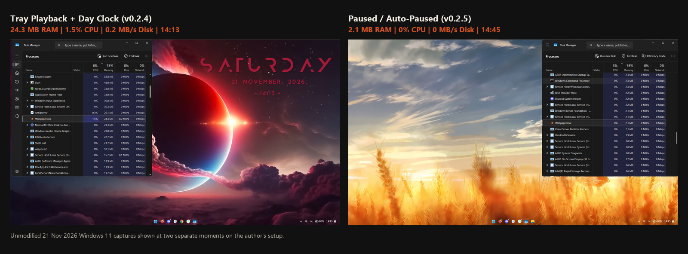

<p align="center">
  
</p>

<h1 align="center">WallpaperLive</h1>
<p align="center"><strong>Bring your own live wallpapers.</strong><br>A native Windows app for playing local videos, GIFs, and images as desktop wallpapers.</p>

<p align="center">
  <a href="https://github.com/Raflyf/WallpaperLive/releases/tag/v0.2.6"></a>
  <a href="https://github.com/Raflyf/WallpaperLive/actions/workflows/ci.yml"></a>
  <a href="LICENSE"></a>
  <a href="https://saweria.co/BuyMatcha"></a>
  <a href="https://yapp.ink/raflyf"></a>
</p>

<p align="center">
  <a href="https://github.com/Raflyf/WallpaperLive/releases/download/v0.2.6/wallpaperlivesetup-v0.2.6.msi"><strong>Download Windows installer</strong></a>
  &nbsp;&middot;&nbsp; <a href="https://livelydesk.vercel.app">Full showcase &amp; docs</a>
  &nbsp;&middot;&nbsp; <a href="CHANGELOG.md">Changelog</a>
  &nbsp;&middot;&nbsp; <a href="#resource-use">Resource use</a>
  &nbsp;&middot;&nbsp; <a href="https://github.com/Raflyf/WallpaperLive/issues">Report a bug</a>
  &nbsp;&middot;&nbsp; <a href="#code-signing-policy">Release verification</a>
  &nbsp;&middot;&nbsp; <a href="#privacy-policy">Privacy policy</a>
</p>

WallpaperLive plays trusted local videos, GIFs, and images across single or multi-monitor Windows desktops. Rust and Win32 keep the control panel native (`Smoked Ink Black` Acrylic with solid fallback), while `libmpv` handles hardware-accelerated playback without a browser engine or account.

> Windows 10/11 x64. Unsigned per-user installer. Wallpapers and `libmpv-2.dll` are not bundled; Setup prompts before downloading a SHA-256 verified decoder when none is found locally. Full interactive showcase, live video demo, and detailed user guide live at [LivelyDesk](<https://livelydesk.vercel.app>).

## Bring your own live wallpapers

WallpaperLive is a desktop wallpaper player and controller, not a wallpaper store or downloader. Its **Library** holds only local files and folders you import (`Add wallpaper` or `Add folder`), leaving originals untouched in their source directories.

For convenience, **Where to find wallpapers** opens third-party websites ([MyLiveWallpapers](<https://mylivewallpapers.com>), [MoeWalls](<https://moewalls.com>), [MotionBGs](<https://motionbgs.com>), [DesktopHut](<https://www.desktophut.com>)) in your default browser without built-in scraping or downloading. Settings also links directly to the companion [LivelyDesk](<https://livelydesk.vercel.app>) suite. Respect creator licenses and import only trusted files.

## Preview

<p align="center">
  
</p>

*Desktop capture supplied on 21 November 2026 (`v0.2.4` UI layout, matching `v0.2.5`) with smoked Ink Black Acrylic enabled and the crimson Day Clock widget. Artwork belongs to its respective owners and is not bundled.*

<details>
<summary>View Desktop Day Clock studio &amp; interactive showcase links</summary>



Watch the continuous 1080p live playback demo, scrub the interactive 4K GPU cache before/after comparison, and inspect every Settings/Task Manager capture on [LivelyDesk](<https://livelydesk.vercel.app/#simulator>).

</details>

## Features

- **Independent multi-display Library:** Import files or subfolders up to 4096 entries (`MP4`, `MKV`, `WebM`, `MOV`, `AVI`, `GIF`, `APNG`, `PNG`, `JPG`, `WebP`), browse a 3x3 grid (`Space`, `Left`/`Right` hotkeys), search/sort, retry thumbnails, or assign distinct wallpapers per monitor or `All displays`.
- **Placement, FPS cap, and Quality tiers:** Choose `Fill` or `Fit`, cap playback at `24`, `30`, `45`, or `60` FPS on running players without reloading, switch 5 cache presets (`Native`, `High`, `Optimize`, `Medium`, `Low`), and choose `GPU` preference (`Auto`, `High Performance`, `Power Saving`).
- **GPU-accelerated 4K caching (v0.2.6):** Oversized SDR videos start immediately while a background worker drops excess frames before scaling and encodes a display-sized H.264/AAC MP4 copy using hardware encoders (`h264_nvenc`, `h264_amf`, or `h264_qsv` following GPU preference) and automatic multi-threaded `libx264` CPU fallback.
- **Smoked Ink Black Acrylic UI:** Toggle native Windows translucent Ink Black (`#111111`) Acrylic blur or solid styling directly in Settings (`Acrylic blur`).
- **Desktop Day Clock widget:** Anurati display typography, 12h/24h toggle, size/opacity sliders, HSV wheel + `#RRGGBB` hex input with `Confirm`, screen color eyedropper, drag/reposition, and behind-desktop-icons layering.
- **2D occlusion & power auto-pause:** Pauses independently per display on fullscreen/maximized windows, battery power, session lock, display sleep, and suspend while retaining the last frame for instant resume.
- **Tray residency & verified updates:** Closing the panel keeps playback in the theme-aware system tray; toggle `Open TransparentBar` from Settings; check updates cleanly with SHA-256 verified MSI downloads.

## Resource use

<p align="center">
  
</p>

| State captured in Task Manager (21 Nov 2026) | Memory | CPU | Notes |
| :--- | ---: | ---: | :--- |
| 4K GPU cache preparation (`v0.2.5`, 14:44:35) | 449.8 MB | 12.8% | App plus background hardware cache worker during ~16 s 4K encode |
| Original 1080p playback, panel open (`v0.2.4`, 14:14) | 46.0 MB | 1.8% | Library panel visible (`0 MB/s` disk, `0 Mbps` network) |
| Screen-sized cache ready, panel open (`v0.2.5`, 14:44:51) | 35.4 MB | 1.8% | Cached playback with Library visible (`0 MB/s` disk) |
| Desktop live playback + Day Clock in tray (`v0.2.4`, 14:13) | 24.3 MB | 1.5% | Panel closed to tray (`0.2 MB/s` disk, `0 Mbps` network) |
| Paused / auto-paused (`v0.2.5`, 14:45) | 2.1 MB | 0% | Playback paused (`0 MB/s` disk, `0 Mbps` network) |

*Snapshot observations on the author's Windows 11 laptop, not fixed ceilings or guarantees. Task Manager rounds live CPU, excludes total private allocations and dedicated VRAM, and varies by codec, resolution, GPU driver, and display count. Full provenance, raw digests, and historical v0.1.3-v0.1.6 logs live in [assets/screenshots/SOURCES.md](assets/screenshots/SOURCES.md).*

<details>
<summary>View tray &amp; auto-pause captures</summary>



</details>

## Download and install

1. [Download wallpaperlivesetup-v0.2.6.msi](<https://github.com/Raflyf/WallpaperLive/releases/download/v0.2.6/wallpaperlivesetup-v0.2.6.msi>) and verify its hash against [SHA256SUMS.txt](<https://github.com/Raflyf/WallpaperLive/releases/download/v0.2.6/SHA256SUMS.txt>).
2. Run Setup as your normal Windows user (no admin rights needed). Store the installer in its own folder without unrelated DLLs.
3. On first video playback without a compatible `libmpv-2.dll`, review the in-app Acrylic consent dialog to download and SHA-256 verify the decoder (or run `scripts\Get-Decoder.ps1` / supply `mpv-dev.7z` offline beside the installer).

[All releases](<https://github.com/Raflyf/WallpaperLive/releases>) &middot; [LivelyDesk User Guide](<https://livelydesk.vercel.app/doc>) &middot; [Release verification](#code-signing-policy)

## Playback, cache, and build details

<details>
<summary>Technical cache limits, hardware encoders, and source build commands</summary>

- **GPU & CPU cache pipeline:** Finite SDR videos (up to 1 hour / 16 GiB) encode in one below-normal-priority worker (15 min / 512 MiB cap, 2 GiB total cache budget under `%LOCALAPPDATA%\WallpaperLive\video-cache`). Hardware-capable PCs use `h264_nvenc`, `h264_amf`, or `h264_qsv` following the selected GPU preference, falling back automatically to multi-threaded `libx264`.
- **Safety boundary:** Playback runs with user privileges, not in a sandbox. URLs, playlists, network paths, and executables are rejected; malformed local files can crash the decoder.
- **Build & verify from source (Rust + MSVC):**

```powershell
powershell.exe -NoProfile -ExecutionPolicy Bypass -File .\scripts\Build.ps1
powershell.exe -NoProfile -ExecutionPolicy Bypass -File .\scripts\Get-Decoder.ps1 -Destination .\target\release\runtime
cargo fmt --all -- --check
cargo clippy --locked --all-targets -- -D warnings
cargo test --locked
powershell.exe -NoProfile -ExecutionPolicy Bypass -File .\scripts\Installer.ps1
```

</details>

## Support

Optional support via [Buy me a coffee](<https://yapp.ink/raflyf>) or [Saweria](<https://saweria.co/BuyMatcha>). Donations never gate or unlock features.

## Code signing policy

WallpaperLive releases (including `v0.2.6`) are currently **unsigned** (no Authenticode code-signing certificate is active). All official binaries and `SHA256SUMS.txt` manifests are built transparently from public source via [Windows checks](<.github/workflows/ci.yml>) on GitHub Actions. Always download from [GitHub Releases](<https://github.com/Raflyf/WallpaperLive/releases>), verify SHA-256 digests before installing, and keep Windows security protections enabled.

## Privacy policy

WallpaperLive collects, stores, or transmits zero personal telemetry, analytics, or local media paths. Library entries, settings, thumbnails, and cached media stay local under `%LOCALAPPDATA%\WallpaperLive`. Optional update checks send one read-only HTTPS `GET` to `api.github.com/repos/Raflyf/WallpaperLive/releases/latest` (`User-Agent: WallpaperLive/<version>`, no cookies or auth), and explicitly confirmed updates or decoder downloads verify SHA-256 digests from GitHub hosts only. External links open your default browser under third-party privacy policies.

## License

[GPL-3.0-or-later](LICENSE) &middot; [Dependency notices](THIRD_PARTY.md) &middot; [Icon sources](assets/SOURCES.md) &middot; [Screenshot sources](assets/screenshots/SOURCES.md)
