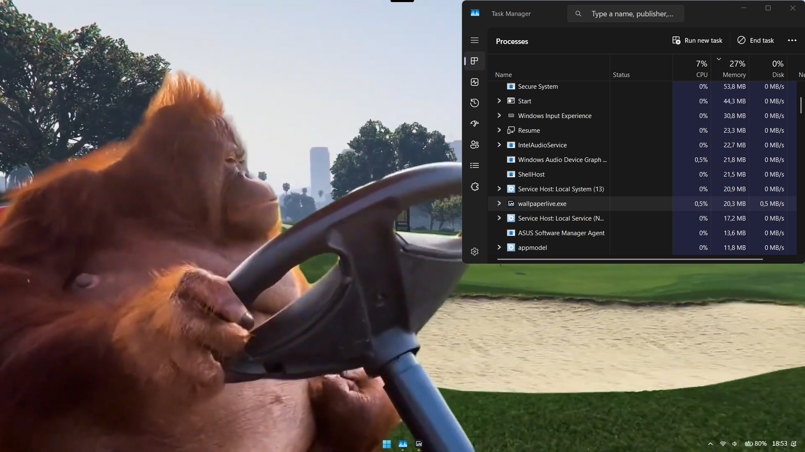
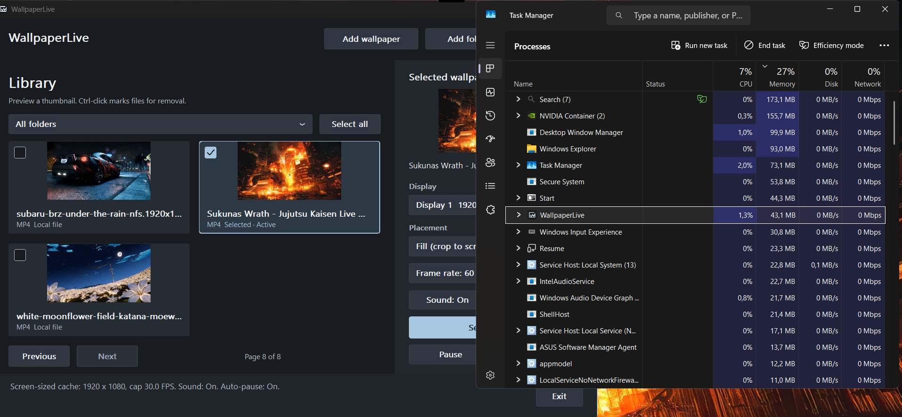
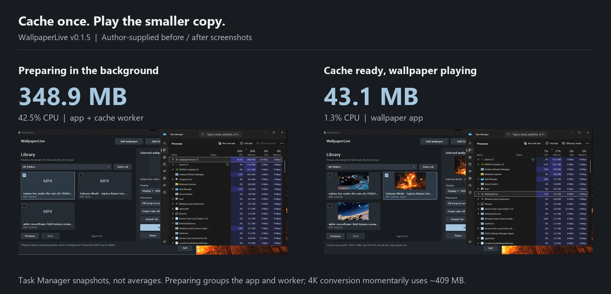
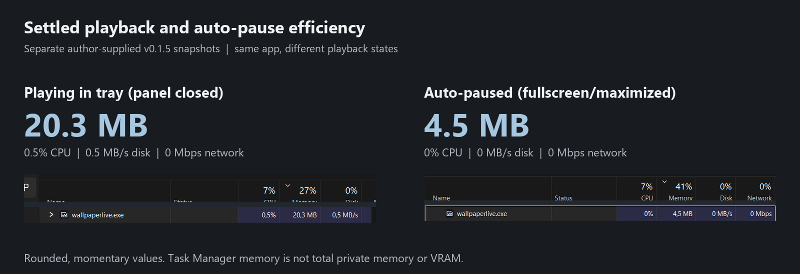

<p align="center">
  
</p>

<h1 align="center">WallpaperLive</h1>
<p align="center"><strong>Your videos. Your desktop.</strong><br>Live wallpapers with a native Windows app, local files and a background display cache.</p>

<p align="center">
  <a href="https://github.com/Raflyf/WallpaperLive/releases/tag/v0.1.6"></a>
  <a href="https://github.com/Raflyf/WallpaperLive/actions/workflows/ci.yml"></a>
  <a href="LICENSE"></a>
</p>

<p align="center">
  <a href="https://github.com/Raflyf/WallpaperLive/releases/download/v0.1.6/wallpaperlivesetup-v0.1.6.exe"><strong>Download Windows installer</strong></a>
  &nbsp;·&nbsp; <a href="CHANGELOG.md">Changelog</a>
  &nbsp;·&nbsp; <a href="#resource-use">Resource use</a>
  &nbsp;·&nbsp; <a href="https://github.com/Raflyf/WallpaperLive/issues">Report a bug</a>
</p>

WallpaperLive plays trusted local videos, GIFs and images on one display you choose. Browse your thumbnail library in a 3x3 grid, set a wallpaper and control playback from the panel or tray. Right-click thumbnails for file actions, use hotkeys (`Space`, `←`/`→`), monitor live RAM and manage your video cache directly in Settings. Rust and Win32 keep the interface native; libmpv handles decoding without a browser engine or an account.

> Windows 10/11 x64. Unsigned installer. Wallpapers and the native decoder are not bundled; Setup asks before downloading a decoder if none is available locally.

## Preview

<p align="center">
  
</p>

*Real v0.1.5 desktop capture supplied by the project author on 8 November 2026, showing active live wallpaper playback. Wallpaper artwork belongs to its respective owners; no media is included in the download.*

<details>
<summary>View the native app at full size</summary>



Select all sits beside the folder filter, away from Previous/Next. Display, Placement, FPS and Sound controls stay with the selected wallpaper. Choosing a thumbnail changes the preview; Set wallpaper changes the active wallpaper.

</details>

## Features

- Import individual files or folders with subfolders. Keep up to 4096 library entries, filter by folder and browse four thumbnails per page. Original files stay where they are.
- Start the original video immediately. Oversized SDR videos get a display-sized cache in the background; playback switches to the finished copy near the current position.
- Choose 24, 30, 45 or 60 FPS below Placement. Changes use the running player without a file reload or another cache conversion. This is a cap, not frame interpolation.
- Use Fill to crop or Fit to show the full frame. Prefer a detected dedicated GPU for compatible D3D11 rendering and hardware decoding, with fallback when needed.
- Loop with sound off by default. Toggle Sound, pause, resume or stop from the app or tray.
- Auto-pause for fullscreen/maximized apps on the wallpaper display, battery power, session lock, display sleep and system suspend. Keep the last frame and decoder attached for resume without reloading.
- Select all within the current filter or Ctrl-click individual files. Remove confirms the count and removes library entries, never original media.
- Keep playback in the tray after closing the panel. The tray follows the Windows dark/light theme; high-contrast mode uses the native system menu. Start with Windows remains opt-in.
- Check for updates from the tray. A background check shows a native English result dialog; a newer release page opens only after confirmation. No automatic download or installation.

## Resource use

### Cache preparation costs more than cached playback

The project author captured the same wallpaper while its display cache was being prepared and after it finished. The app plays the original media immediately in the foreground while conversion runs in the background.

<p align="center">
  
</p>

| State captured in Task Manager | Memory shown | CPU shown | What the row includes |
| :--- | ---: | ---: | :--- |
| Background cache preparation | 348.9 MB – 409.3 MB | 42.5% – 50.3% | App plus background cache worker (temporary conversion; ~350 MB on 1080p, up to ~409 MB peak specifically when converting 4K media) |
| Cache ready, panel open | 43.1 MB – 45.4 MB | 1.3% – 2.6% | WallpaperLive app with library and controls visible |
| Minimized to tray (live playback) | 20.3 MB | 0.5% | WallpaperLive actively rendering live wallpaper on desktop with panel closed to tray |
| Fullscreen/maximized auto-pause | 4.5 MB | 0% | WallpaperLive app, playback paused |

The author reports a temporary peak around **350 MB for 1080p and up to ~409 MB specifically when converting high-resolution 4K wallpapers** (where two decoder/encoder processes run concurrently during initial background cache generation), dropping to **~43–45 MB with the control panel open**, and settling to **20.3 MB / 0.5% CPU when minimized to the system tray**. When an application is maximized or fullscreen, auto-pause reclaims resident pages down to **4.5 MB / 0% CPU**. These ranges describe that user's experience on Windows 11, not a fixed memory ceiling or a synthetic benchmark.

### Tray playback efficiency and auto-pause

<p align="center">
  
</p>

*Task Manager headers and selected rows are cropped and arranged for readability; displayed values are unchanged. These are separate moments, not a controlled before/after benchmark.*

**Read the numbers in context.** These v0.1.5 snapshots were supplied on 8 November 2026. Initial conversion memory peaks (~350 MB for 1080p and ~409 MB for 4K) are strictly temporary while encoding the display cache; once prepared, playback uses only ~20.3 MB in tray. Task Manager rounds live values; displayed 0% CPU is not proof of zero work. Its Memory column is not total private allocation, all process-tree memory or dedicated VRAM. Media, codec, display resolution, driver and cache state affect usage. No fixed RAM ceiling or GPU/VRAM savings are guaranteed.

<details>
<summary>Open the original screenshots</summary>

- [Cache preparation (1080p): 348.9 MB, 42.5% CPU](assets/screenshots/cache-preparing-v0.1.5.png)
- [Cache preparation (4K wallpaper conversion): 409.3 MB, 50.3% CPU](assets/screenshots/cache-preparing-4k-v0.1.5.png)
- [Cache ready, panel open: 43.1 MB, 1.3% CPU](assets/screenshots/cache-ready-v0.1.5.png)
- [Tray playback on desktop: 20.3 MB, 0.5% CPU](assets/screenshots/desktop-playing-tray-v0.1.5.png)
- [Panel playback snapshot: 45.4 MB, 2.6% CPU](assets/screenshots/task-manager-playing-v0.1.5.png)
- [Auto-paused: 4.5 MB, 0% CPU](assets/screenshots/task-manager-paused-v0.1.5.png)

The tray capture also shows 0.5 MB/s disk and 0 Mbps network; paused shows 0 MB/s disk and 0 Mbps network. They do not measure GPU utilization or VRAM.

</details>

## Download and install

1. [Download wallpaperlivesetup-v0.1.6.exe](https://github.com/Raflyf/WallpaperLive/releases/download/v0.1.6/wallpaperlivesetup-v0.1.6.exe) and run it as your normal Windows user.
2. If Setup needs a native decoder, review its download prompt and grant consent to continue. A matching installed decoder or verified local archive skips the download.
3. Open WallpaperLive from the Start menu, add trusted local media, choose a thumbnail/display and select Set wallpaper.

[Installer checksum](https://github.com/Raflyf/WallpaperLive/releases/download/v0.1.6/SHA256SUMS.txt) · [All releases](https://github.com/Raflyf/WallpaperLive/releases)

Installer downloads include the release version, such as `wallpaperlivesetup-v0.1.6.exe`, so different versions can sit in the same download folder. Downloading the same version twice may still add a browser suffix such as `(1)`.

Open **Settings** to see the installed app's **Version**, taken from the executable's build rather than the installer filename.

Setup installs per user without administrator rights. It provides an option to launch the app on completion, but does not apply a wallpaper or enable startup automatically. These builds are unsigned: keep Windows security protections enabled. Store the installer in a dedicated folder without unrelated DLLs; do not run as administrator to bypass desktop access errors.

<details>
<summary>Offline install or upgrade</summary>

For an upgrade, install into the same folder; Setup reuses a matching decoder. For a first install without an in-setup download, obtain the [pinned upstream archive](https://github.com/shinchiro/mpv-winbuild-cmake/releases/download/20261107/mpv-dev-x86_64-20261107-git-9028187538.7z), rename it `mpv-dev.7z` and place it beside the installer. Setup verifies both archive and DLL SHA256 values.

The decoder remains a separate download. Its complete dependency-source record has not been verified for redistribution; the installer does not republish it.

</details>

## Playback notes

Selecting a thumbnail changes the preview, not active playback. Use Set wallpaper to apply it. Sound: On/Off selects or disables the media's audio track; files without audio stay silent. Stop removes the live wallpaper without changing your Windows static wallpaper settings. Exit closes the app; closing the panel keeps it in the tray when the tray is available.

The picker accepts `MP4`, `GIF`, `MKV`, `WebM`, `MOV`, `AVI`, `MPG`, `MPEG`, `M4V`, `APNG`, `PNG`, `JPG`, `JPEG`, `BMP` and `WebP`. Codec support still depends on libmpv and your GPU. HDR and animated-image inputs use their original media rather than the SDR cache.

<details>
<summary>Cache, FPS and retained-pause details</summary>

- Cache conversion uses the installed libmpv encoder. It preserves originals, audio, aspect ratio and playback speed; smaller sources are not upscaled. H.264/AAC MP4 copies are keyed by source SHA256, display dimensions and a source-rate profile capped at 60 FPS, independent of the runtime cap.
- Runtime FPS changes use a pure frame-rate filter, without interpolation or playback-speed changes. CFR resampling can repeat frames around irregular timestamps; decoding still processes the cached source rate. One isolated native v0.1.3 test measured scheduled rates of 59.6 / 24.2 / 60.2 FPS for 60 / 24 / 60 choices, not physical display scanout.
- Conversion accepts finite video up to one hour/16 GiB, uses one below-normal-priority worker and stops at 15 minutes or 512 MiB per output. Cache budget is 2 GiB; unused generated copies may be evicted near that budget. Original media is never removed. Cancelled partials are never played. Cache lives in `%LOCALAPPDATA%\WallpaperLive\video-cache`.
- Pause stops animation/audio, releases thumbnails and cancels/defer conversion. Windows receives a resident-page trim request on confirmed pause, load completion and hiding the panel; this can reclaim resident pages without releasing private decoder allocations or dedicated VRAM. Pages can become resident again and page faults can increase. An unfinished conversion restarts in the background after resume. A completed cache waits at least two seconds after resume before a separate handoff near the current media position.
- Only four visible thumbnails plus the selection are retained, each at most 480 × 270 pixels. Hidden, minimized or paused panels drop those buffers. Packet settings are 4 MiB forward, no backward cache and 0.2 seconds readahead, with two software-decode threads. These are not a total RAM cap.
- The encoder uses x264 `veryfast`, CRF 23, two threads, lookahead 10 and one reference frame (`refs=1`). Reference/lookahead values already match `veryfast`; an additional 75% memory saving was not measured. CRF encoding is lossy, not a guarantee of identical pixels.

Historical v0.1.1 comparison, **not the screenshot results above**: one sequential RTX 3050 Laptop GPU fixture pair used a 1920 × 1080 native window with D3D11VA decoding for 15 seconds per condition. Original 4K/60 FPS used median 275.5 MiB working set / 856.3 MiB private bytes; 1080p/30 FPS cache used 187.1 MiB / 355.1 MiB. Process CPU was 3.79% / 1.84% of total machine capacity. After decoder destruction, working sets were about 57 MiB including the Python host, excluding the app panel. It was not a repeatability test; GPU utilization and VRAM were not measured.

</details>

## Safety and compatibility

The native decoder runs with your user privileges, not in a sandbox. Use media you trust: malformed files can crash the app. URLs, network paths, playlists and executable files are not accepted.

Desktop attachment can vary with Windows builds, HDR, virtual desktops, display reconnection and GPU drivers. The supplied screenshots establish one real setup, not compatibility with every device or media file. If Windows blocks Explorer access, leave playback stopped. Bug reports should include app version, Windows build, GPU, media format and reproduction steps.

## Build from source

Install a Rust toolchain with its Windows linker prerequisites, then build the app and obtain its decoder:

```powershell
cargo build --locked --release --bin wallpaperlive
powershell.exe -NoProfile -ExecutionPolicy Bypass -File .\scripts\Get-Decoder.ps1 -Destination .\target\release\runtime
```

[Get-Decoder.ps1](scripts/Get-Decoder.ps1) performs an explicit checksum-verified download. Release builds load the decoder beside the executable, never from a media folder or PATH.

<details>
<summary>Source checks and installer delivery</summary>

```powershell
cargo fmt --all -- --check
cargo clippy --locked --all-targets -- -D warnings
cargo test --locked
```

[Windows checks](.github/workflows/ci.yml) builds the application and installer on GitHub Actions. Download the installer and SHA256 manifest from the run's `wallpaperlive-windows-x64` artifact. Version tags beginning with `v` publish those same files after checks pass; tags containing `-` are prereleases. CI does not install the app or exercise live desktop playback.

For maintainer packaging, [Installer.ps1](scripts/Installer.ps1) runs after a release build and downloads a checksum-verified portable Inno Setup compiler when needed, without a global tool install:

```powershell
powershell.exe -NoProfile -ExecutionPolicy Bypass -File .\scripts\Installer.ps1
```

Setup File version is `0.1.6.0`; Product version is `0.1.6`. The installer build reads the output's PE version metadata and rejects a mismatch before publication.

</details>

## License

[GPL-3.0-or-later](LICENSE) · [Dependency notices](THIRD_PARTY.md) · [Screenshot sources](assets/screenshots/SOURCES.md)

WallpaperLive's GPL license covers the app, not third-party wallpaper artwork shown in screenshots. libmpv is a separate native decoder; no wallpapers or decoder binaries are bundled.
